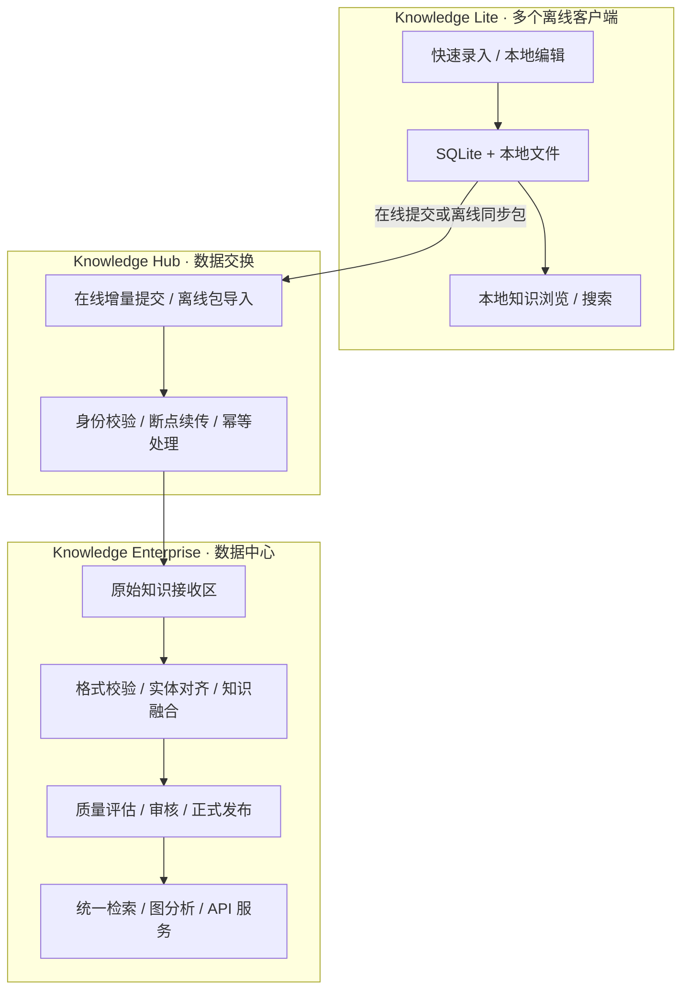
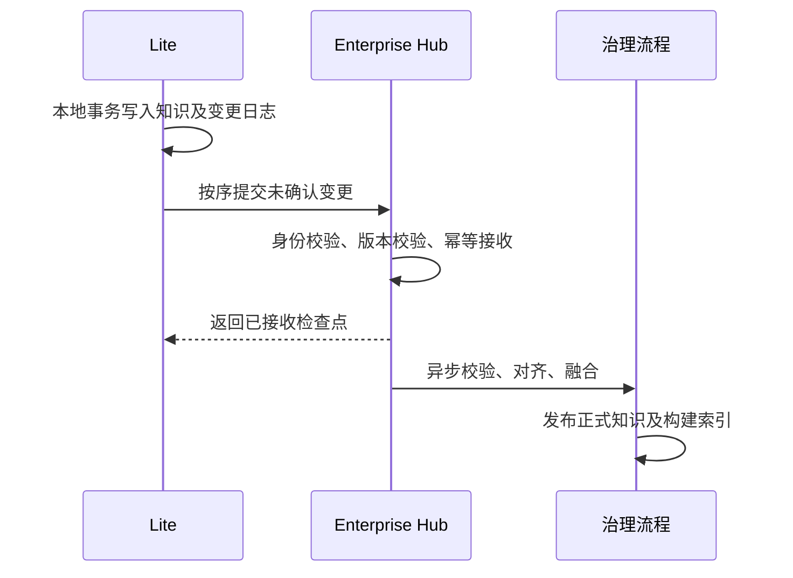

# Knowledge Graph

**离线优先的知识采集客户端与集中式知识治理、图分析平台。**

> 架构规划状态：本文定义目标架构与渐进实施路线，不代表 Lite / Enterprise 双模式、跨端同步、ArangoDB、Elasticsearch 或 MinIO 已在当前代码中全部实现。现阶段项目主要基于 Bun、SQLite 与原生 Web 前端运行。

## 1. 项目定位

Knowledge Graph 采用**一个代码仓库、共享核心能力、两种产品运行模式**的设计。Lite 面向个人或一线工作人员，提供简洁的知识录入、离线管理和可视化浏览；Enterprise 面向组织数据中心，负责多源知识汇聚、知识治理与融合、统一检索、图分析和 API 服务。

- **Knowledge Lite（客户端）**：快速录入、文件与网页资料摘录、轻量结构化、本地搜索、列表/表格/关系网络/时间轴等知识浏览、离线存储、向中心提交知识。
- **Knowledge Enterprise（数据中心）**：接收多个客户端提交的数据，保留原始来源，进行校验、对齐、融合、质量评估、正式知识发布、跨知识库检索、图分析和统一 API 管理。
- **Knowledge Hub（交换模块）**：作为 Enterprise 内部模块，处理客户端注册、知识提交、在线增量同步、离线交换包、状态反馈、来源映射及审计；初期不单独部署为微服务。

核心原则：**Lite 独立可用，Enterprise 集中治理；上传不等于融合，中心融合不覆盖客户端原始知识。**

## 2. 总体架构



### 2.1 产品职责

| 能力 | Lite | Enterprise |
| --- | --- | --- |
| 快速录入、文本框选、文件导入 | 核心功能 | 可选 |
| 本地知识编辑与管理 | 简洁操作 | 完整管理与审核 |
| 列表、表格、卡片浏览 | 核心功能 | 支持 |
| 关系网络、时间轴、语义地图 | 轻量浏览 | 深度分析 |
| 搜索 | 本地搜索 | 跨库、高级检索 |
| 本体和属性 | 使用预设模板 | 统一管理和维护 |
| 数据清洗 | 基础格式检查 | 完整 ETL、对齐和融合 |
| 知识质量评估 | 不作为核心功能 | 核心功能 |
| 图路径、关联、网络分析 | 不作为核心功能 | 核心功能 |
| 同步 | 上行提交、查看状态 | 接收、治理、发布 |
| 统一知识 API | 不作为核心功能 | 核心功能 |

Lite 的操作应尽量避免要求用户理解本体、图节点或图边。推荐使用**名称、类型、描述、标签、属性、关联知识和附件**等简单表单，并支持“粘贴全文 + 鼠标框选提取”。

## 3. 一套代码，两种运行模式

目标采用配置控制功能，而非复制两个项目：

```dotenv
APP_MODE=lite
# 或 APP_MODE=enterprise
```

**注意：`APP_MODE` 为规划中的配置项，尚不能假定当前版本已实现切换。** 第一阶段可让两种模式都基于现有 SQLite 运行，先验证功能边界和同步闭环；后续再扩展 Enterprise 的存储能力。

运行模式决定前端导航、后端路由授权、可用模块和默认存储适配器。**不能只隐藏菜单而继续暴露受限 API。** 同一代码仓库不等于同一运行实例：每个 Lite 客户端和 Enterprise 服务拥有独立进程及数据。

### 3.1 目标逻辑模块

```text
knowledge_graph/
├── src/
│   ├── core/                  # 规划：共享知识模型与服务接口
│   │   ├── knowledge/         # 知识读写、ID、版本与来源
│   │   ├── search/            # 统一搜索接口
│   │   ├── storage/           # 文件存储接口
│   │   └── sync/              # 知识交换协议
│   ├── lite/                  # 规划：快速录入、离线浏览、上行提交
│   ├── enterprise/            # 规划：接收、融合、治理、图分析
│   └── server/                # 现有 Bun 服务及路由
├── public/                    # 现有原生 Web 前端
├── docs/                      # 项目文档
└── scripts/                   # 开发、数据处理脚本
```

上述 `core/lite/enterprise` 是**目标逻辑边界**，不要求立即搬迁现有代码。优先以新增接口和小范围适配实现。

### 3.2 与当前代码的衔接

| 当前代码或文档 | 处理策略 |
| --- | --- |
| `src/server/index.ts` | 保留 Bun 服务入口，未来注册模式配置和同步路由 |
| `src/server/db.ts` | 保留 SQLite 能力，逐步解决请求级知识库上下文隔离 |
| `src/server/routes/core-kb.ts` | 保留现有知识 API，逐步引入统一数据访问接口 |
| `src/server/pipeline/` | 保留现有录入、清洗、融合流程，作为 Enterprise 治理基础 |
| `src/server/routes/semantic-map.ts` | 保留现有语义地图浏览接口 |
| `public/` | 复用原生前端，按运行模式配置页面导航 |
| [数据录入与知识清洗说明](docs/data-pipeline.md) | 保留现有功能与接口的详细说明 |

现有 `src/server/index.ts` 通过请求 `db` 参数触发 `switchDatabase()`。在支持多客户端和多知识库之前，应检查全局数据库切换是否存在并发请求相互影响的问题，逐步改为请求级上下文，不宜直接在本轮架构规划中重构。

## 4. 数据模型与知识归属

### 4.1 统一交换格式

Lite 与 Enterprise **共享逻辑知识模型，不要求使用同一种数据库**。客户端可继续使用现有 SQLite 表；同步层负责将知识转换成稳定的交换对象。

```json
{
  "schemaVersion": 1,
  "source": {
    "clientId": "lite-a",
    "localId": "node-1001"
  },
  "version": 3,
  "deleted": false,
  "data": {
    "type": "设施",
    "labels": { "zh": "诺福克海军基地" },
    "tags": ["基地"],
    "descs": {},
    "claims": {}
  }
}
```

这是**协议示例**，不是现有数据库表结构的替代方案。知识 ID、来源命名空间和版本号必须稳定；来自不同客户端的本地 ID 不能直接当作全局唯一 ID。

### 4.2 原始知识与正式知识分离

- **客户端原始知识**：Lite 可继续本地编辑、离线保存，用户可决定哪些内容提交。
- **中心接收知识**：保留提交批次、客户端 ID、本地 ID、版本、文件引用及原始内容。
- **中心正式知识**：经过格式校验、实体对齐、属性映射、融合、审核后形成可查询、可分析的权威知识。
- **来源映射**：保存“客户端 ID + 本地 ID → 中心接收记录 → 正式知识 ID”的关联，支持多个来源对应一个正式知识。

**中心融合结果不自动覆盖 Lite 的本地原始数据。** 后续如需中心知识下发，应作为独立的订阅/分发功能设计，而不是第一阶段的双向数据库同步。

## 5. 知识同步设计

第一阶段仅实现 **Lite → Enterprise 单向提交**。同步目标是传输知识变更和附件，而不是直接复制 SQLite 数据库文件。

### 5.1 在线增量同步



建议以**知识变更日志（Outbox）+ 每目标同步检查点**实现断点恢复。新增、修改、删除均应产生事件；删除需保留墓碑信息。接收端按事件 ID 去重，重复提交不应产生重复知识。检查点只在接收端确认后推进。

同步状态至少区分：**本地待提交、传输中、中心已接收、治理中、已发布、失败/需处理**。中心接收成功不代表知识已融合发布。

### 5.2 离线同步

离线环境采用可携带的同步 ZIP 包：

```text
knowledge-sync.zip
├── manifest.json          # 来源、知识库、起止序号、校验信息
├── changes.jsonl          # 变更事件
├── knowledge.jsonl        # 知识快照
└── files/                 # 必需的附件内容
```

支持首次全量快照和后续增量包。离线导出不等于同步成功；目标导入并生成确认结果后才能更新发送端检查点。导入必须校验哈希、包版本、来源、权限、路径安全和幂等性。

### 5.3 文件管理

知识引用稳定的 `fileId` 和相对 `objectKey`，不引用客户端绝对路径。Lite 使用本地目录；Enterprise 后续可使用 MinIO。传输时携带文件大小、类型和 SHA-256，用于校验与去重。知识元数据与文件内容的导入状态应可追踪。

## 6. 存储与基础设施演进

| 能力 | Lite | Enterprise 初期 | Enterprise 扩展 |
| --- | --- | --- | --- |
| 主数据 | SQLite | SQLite | ArangoDB 或可替换数据库 |
| 知识关系 | 现有关系模型 | 现有关系模型 | 图数据库遍历与分析 |
| 检索 | SQLite / FTS5 评估 | SQLite / FTS5 评估 | Elasticsearch |
| 附件 | 本地文件目录 | 本地文件目录 | MinIO |
| 异步任务 | Bun Worker + 持久化任务表 | Bun Worker + 持久化任务表 | 独立 Worker、按需引入队列 |
| 同步 | 上行提交/离线导出 | Hub 接收/导入 | 多客户端规模化接入 |

**不应一开始就同时引入 ArangoDB、Elasticsearch、MinIO、Redis 和 Kafka。** 首先跑通 Lite 到 Enterprise 的完整业务闭环，再依据数据规模、全文检索质量、图查询复杂度和任务吞吐量逐步升级。SQLite FTS5 的中文检索方案需要单独验证。

Enterprise 的主数据、图边、全文索引和附件之间要明确权威来源与重建机制：**搜索索引和图分析索引可重建，不能形成互不一致的多份主数据。**

## 7. 任务与统一 API

Lite 的长耗时导入、离线导出可使用本地持久化任务；Enterprise 的批量接收、清洗融合、图索引和搜索索引更新应异步执行。初期使用 SQLite 任务表和 Bun Worker 即可，后续再评估 Redis 队列等组件。

规划中的 API 分组：

| 接口组 | 作用 |
| --- | --- |
| `/api/kb/*` | 沿用现有知识操作接口 |
| `/api/kb/pipeline/*` | 沿用现有录入、清洗、确认接口 |
| `/api/sync/status` | 查看客户端同步状态 |
| `/api/sync/push` | 客户端触发上行提交 |
| `/api/sync/export` | 生成离线同步包 |
| `/api/sync/import` | 中心导入离线同步包 |
| `/api/sync/apply` | 中心接收经过认证的变更批次 |
| `/api/tasks/*` | 查询、取消异步任务 |

**同步及任务接口均为规划接口，尚非当前项目已实现 API。** 需要复用现有身份认证、知识库权限和审计机制，避免跨应用/跨知识库数据泄露。

## 8. 逐步实施路线

| 阶段 | 目标 | 验收结果 |
| --- | --- | --- |
| 1. 产品模式 | 明确 Lite/Enterprise 功能边界、导航与权限 | 一套代码可按配置展示不同产品入口 |
| 2. Lite 体验 | 简化录入、完善离线管理和可视化浏览 | 不联网可完成录入、编辑、搜索与浏览 |
| 3. 统一交换模型 | 规范知识 ID、来源、版本、附件引用 | 现有知识可无损导出/导入标准格式 |
| 4. 同步闭环 | 增量日志、在线提交、离线包、状态反馈 | 两个 SQLite 实例可完成单向同步与恢复 |
| 5. 中心治理 | 接收区、来源映射、对齐融合、发布 | 多客户端同类知识可追溯、可融合 |
| 6. 企业级扩展 | 图数据库、ES、MinIO、异步任务扩容 | 在不改变 Lite 协议前提下按需替换后端 |

实施顺序遵循**先产品与数据流，再模块接口，最后替换基础设施**。当前阶段以架构设计为主，不要求一次性重构代码。

## 9. 关键约束

- **离线优先**：Lite 断网时仍可使用，联网后继续提交未确认数据。
- **数据隔离**：每个客户端、知识库、应用的来源标识和权限边界明确。
- **可追溯**：原始知识、提交批次、融合结果、版本与操作日志可关联。
- **幂等可靠**：重复提交、网络中断、部分失败、删除与重试均有明确处理方式。
- **安全性**：禁止在 README、代码仓库和日志中保存明文密码、令牌及生产凭据；首次管理员密码应安全生成并及时更换。
- **兼容性**：保留现有 Bun、SQLite、原生前端与清洗流程，后续按需支持 ARM64、国产化及离线安装。
- **部署边界**：一个仓库共享核心代码；客户端与中心是独立部署实例，不共享同一 SQLite 文件。

## 10. 当前项目启动与已有能力

### 环境与启动

项目目前使用 Bun 作为服务运行环境：

```bash
bun install
bun run dev
```

服务入口：`src/server/index.ts`。默认端口为 `8080`，可使用 `HOST` 和 `PORT` 环境变量覆盖。

- 本机主页：`http://localhost:8080/`
- 语义地图：`http://localhost:8080/semantic-map.html`

### Docker Compose 部署版本

Lite 版只启动应用，SQLite 数据保存在仓库上一级的 `data` 目录（挂载到容器内 `/data`，与服务入口的数据库路径一致）：

```bash
docker compose up -d
```

Enterprise 版同时启动 SQLite、ArangoDB 和 Elasticsearch。首次启动前复制环境变量模板并设置强 ArangoDB root 密码：

```bash
cp .env.example .env
# 编辑 .env，设置 ARANGO_ROOT_PASSWORD
docker compose -f docker-compose.enterprise.yml up -d
```

PowerShell 下可用以下命令复制模板：

```powershell
Copy-Item .env.example .env
```

两个版本都可通过 `http://localhost/` 访问应用。Enterprise 版的 ArangoDB Web 界面为 `http://localhost:8529/`（用户名 `root`，密码为 `.env` 中的 `ARANGO_ROOT_PASSWORD`），Elasticsearch 地址为 `http://localhost:9200/`。Enterprise 版容器间可分别通过 `http://arangodb:8529` 和 `http://elasticsearch:9200` 访问数据库。

Enterprise 与 Lite 共用仓库上一级 `data` 目录中的 SQLite 文件（挂载到容器内 `/data`），并额外启动 ArangoDB 和 Elasticsearch。启动时会直接使用每个应用的 `projects.name` 作为对应的 ArangoDB 数据库名，不添加前缀或 ID；ArangoDB 要求项目短名为 1–64 位、以字母开头，且只含字母、数字、下划线或短横线。Enterprise 会在创建应用时校验此规则，已有不符合规则的应用需先改名。每个库会初始化 `entity` 文档集合、`link` 边集合、`graph` 图和 `entity_view` 搜索视图。`entity` 文档保存多语言 `labels`、`descriptions`、`aliases`，不嵌入属性；未带语言标记的名称、描述和别名按 `zh` 写入，已带语言标记的数据按语言码归组。所有 SQLite 属性声明均作为 Wikidata 风格 claim 写入 `link` 边集合：实体关系的 `_to` 指向目标实体，非实体属性的 `_to` 与 `_from` 均指向其所属实体。数组型 `datavalue.value` 会拆成多条边，每条边的 `datavalue.value` 是单值。Elasticsearch 会为每个应用创建 `entity-<应用名>` 索引，并同步该应用的实体文档；为符合 ES 索引命名要求，名称转换为小写且下划线替换为短横线，若转换后索引名冲突则启动报错。节点及属性变更通过 SQLite outbox 同步到 ArangoDB 和 Elasticsearch；SQLite 仍是权威数据源，ArangoDB 中的用户数据库权限为只读，避免绕开 SQLite 权限校验直接写入导致数据不一致。Enterprise Compose 将 `KNOWLEDGE_SEARCH_BACKEND` 设为 `elasticsearch`，并通过 `ARANGO_URL` 自动启用同样的强制规则。知识列表和关键词检索直接从 Elasticsearch 对应应用索引读取，分类、隐藏实体及有效本体筛选也在 ES 中执行；索引通过增量同步维护实体分类。属性值、类型树及媒体专项筛选仍需结合 SQLite，权限检查仍在应用层执行；实体关联关系从 ArangoDB 查询。ES 未配置时返回 503，不会静默退回 SQLite。Lite 版继续从 SQLite 查询。检索接口返回的 `searchBackend` 字段标识本次实际使用的数据源。

SQLite、ArangoDB 和 Elasticsearch 数据分别持久化；执行 `docker compose down` 后仍会保留。仅在需要清除数据时执行对应配置的 `docker compose ... down -v`。ArangoDB 和 Elasticsearch 端口仅绑定到本机回环地址；Elasticsearch 未启用身份验证，仅适用于本地开发。

用户注册时会创建对应的 ArangoDB 内置用户；已有用户在首次成功登录时同步密码和账号状态。ArangoDB 用户是服务级账号，权限按应用成员关系授予只读数据库访问；SQLite 只存密码哈希，因此现有用户无法在启动时批量恢复明文密码并创建 ArangoDB 账号。

例如仅本机访问：

```bash
HOST=127.0.0.1 PORT=8080 bun run dev
```

### 当前功能与文档

现有项目包含知识管理、语义地图以及数据录入与知识清洗原型。语义地图读取 `nodes` 的知识内容，`semantic_nodes` 保存语义坐标及渲染索引。已有接口包括：

```text
GET /api/semantic-map/init
GET /api/semantic-map/viewport
GET /api/semantic-map/detail/:id
GET /api/semantic-map/search?q=keyword
```

已有录入流程支持 MySQL、CSV、Excel、JSON 和 Wikidata 读取，保存二维实体表，通过可视化流程完成本体对齐、属性对齐、实体对齐与知识融合，确认后写入知识库。详细说明见 [docs/data-pipeline.md](docs/data-pipeline.md)。

离线生成语义坐标的现有脚本为 `scripts/generate-semantic-coordinates.py`，相关依赖和运行细节可直接查看脚本。

### 验证命令

```bash
bun test
bun run typecheck
```

历史文档记录存在部分既有 TypeScript 类型错误，因此应以实际运行和当前测试结果为准，不应将架构规划视为已经完成的功能交付。

---

**设计结论：** Knowledge Graph 将逐步演进为“Lite 负责采集与离线浏览、Enterprise 负责融合治理与图分析、Hub 负责可靠知识交换”的统一平台。优先保持一套代码和现有技术基础，通过明确产品边界、统一知识交换模型及增量同步机制逐步实现，而非立即进行全面重构。
